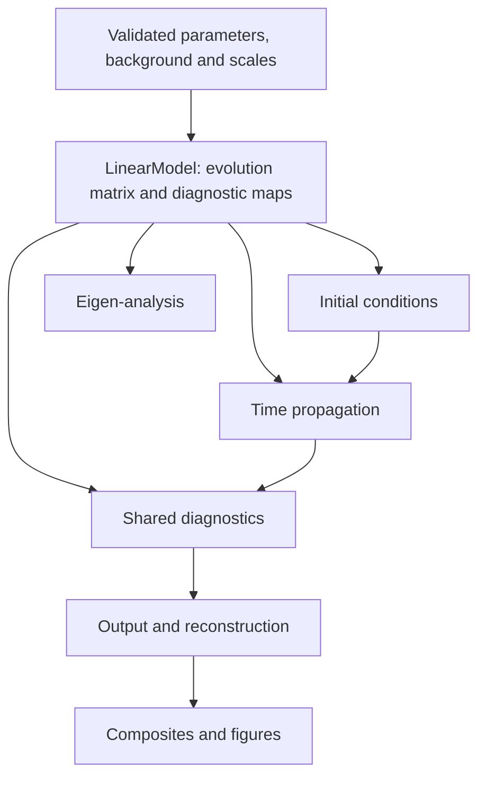

# 2026-11-22 20:39:06 +08:00

**Two-way model structure and modeling suggestions**  
**Time zone:** Asia/Taipei  
**Scope:** Model structure, physical interactions, experiment design, and analysis interfaces.  
**Status:** Review recommendations; this document does not implement changes to the model.

The main recommendation is to give simulation, eigen-analysis, initialization, and diagnostics one shared model definition. The existing separation between calculation and file writing is useful and should be preserved. Inherited parameters and independently constructed defaults currently make physical interactions and parameter changes harder to inspect.

## Current model and module interactions

The main entry points are in [src/API.py](src/API.py). Simulation calculations are coordinated by [SimulationRun.py](src/SimulationAnalysis/SimulationRun.py), time integration is performed by [TimeStepper.py](src/ModelCalculation/TimeStepper.py), and the evolution matrix is assembled by [Operators.py](src/ModelCalculation/Operators.py). Eigen-analysis constructs an operator separately in [EigenModes.py](src/SimulationAnalysis/EigenModes.py).

For the two-way state `(w1, w2, T1, T2, q, L)`, the physical interactions are:

| Process | Main interaction |
| --- | --- |
| Dynamics | Temperature drives modal motion; motion changes temperature through vertical advection. |
| Moisture | Motion supplies moisture; convective heating dries or moistens the atmosphere through its modal contributions. |
| Convection | The moisture deficit `q - 1.5*T1` and modal motion influence convective adjustment and the distribution of heating. |
| Radiation | Radiative heating responds instantaneously to motion and influences temperature and convective adjustment. |
| Background and reconstruction | Background profiles convert modal variables into physical fields and support diagnostics. |

The convective heating relations are `U = r0*L + rq*(q - 1.5*T1)`, `J1 = L + U`, and `J2 = L - U`. The moisture budget is `qdot = a1*w1 + a2*w2 - d1*J1 - d2*J2`.

Reconstructed stability, including `N2`, is a diagnostic. It does not update the evolution matrix during a simulation.

## 1. Put all physical parameters into the run configuration

**Priority: High**

[ModelConfig.py](src/Configuration/ModelConfig.py) currently contains the model type, radiation scaling, domain, and seed. Most physical parameters enter through defaults defined in [Params.py](src/Configuration/Params.py) and inherited by calculation classes.

Read-only checks identified two examples of configuration drift:

- Changing an LW coefficient after operator construction leaves its cached LW-plus-SW total unchanged. Increasing `alpha11_LW` by `0.1` changed the component sum from `0.0465` to `0.1465`, while the cached total remained `0.0465` and the calculated matrix did not change.
- Custom background constants can appear in the configuration snapshot while the background generator uses defaults. A domain with `GammaT = 0.005`, `T0 = 310`, and `g = 9.7` was recorded with those settings, while the generated background used `0.0065`, `300`, and `9.81`.

### Suggested improvement

Give each run explicit dynamics, moisture, convection, radiation, background, and reference-scale settings. Validate them once and keep them fixed throughout the run. Calculate derived values, such as total radiation coefficients and convective factors, from those settings.

Use one authoritative input path for physical parameters. The existing TOML file is not currently loaded by the model classes; its role should be explicit if it is retained or adopted as an input format.

### Verification

Changing a supported physical parameter should affect the intended calculation, appear in saved metadata, and be used consistently by simulation and eigen-analysis. Analysis of a saved run should remain reproducible after current source defaults change.

## 2. Separate the numerical solver from physics through composition

**Priority: High**

The current inheritance chain includes:

```text
TimeStepper -> InitialCondition -> Operator -> RadiationOperator -> parameter classes
```

A time integrator needs an evolution matrix, a time axis, and an initial state. Inheriting initialization and physical parameterizations gives it several responsibilities.

### Suggested improvement

Keep the matrix-exponential solver and pass a shared model definition into it explicitly. Initialization, eigen-analysis, and diagnostics should consume that same definition.

A useful target structure is:



Preserve [SimulationWriter](src/Output/ModelIO.py) as a consumer of completed histories and metadata. File writing should remain independent of initialization and time integration.

### Verification

The same run configuration and wavenumber should produce the same evolution matrix through initialization, propagation, and eigen-analysis. Structural refactoring should preserve existing numerical results before any intentional equation changes are introduced.

## 3. Give physical processes clear inputs and outputs

**Priority: High**

[Operators.py](src/ModelCalculation/Operators.py) expands most interactions directly into matrix entries. Heating is calculated separately in [SimulationRun.py](src/SimulationAnalysis/SimulationRun.py), and radiation is reconstructed again in an analysis notebook.

### Suggested improvement

Define reusable physical maps and assemble the evolution matrix from them:

| Process | Inputs | Outputs |
| --- | --- | --- |
| Convective heating | `q`, `T1`, `L` | `U`, `J1`, `J2` |
| Radiative heating | `w1`, `w2`, radiation parameters | LW and SW modal heating |
| Moisture budget | Motion and convective heating | Moisture tendency |
| Convective adjustment | Motion, moisture deficit, radiative heating | `L` tendency |

Use these definitions both in matrix assembly and in saved diagnostics. Expose process contributions so a tendency can be inspected as dynamics, convection, moisture, or radiation contributions.

The radiation module should calculate radiative heating. The convective closure should determine how that heating affects `L`. [Radiation.py](src/ModelCalculation/Radiation.py) currently embeds part of that convective response.

The previously identified radiation normalization concern remains conditional on the intended closure. If radiation enters the existing quasi-equilibrium balance, its contribution to `Ldot` includes division by `tau*B`. If the current term is a separately calibrated empirical tendency, document its units and calibration. Establish that model definition before changing the equation.

### Verification

Compare matrix tendencies with independently evaluated temperature, moisture, and convective-adjustment equations. Exercise nonzero radiation and several valid parameter combinations, including different relaxation times and convective factors.

## 4. Clarify the relationship between background structure and modal dynamics

**Priority: High for background-sensitivity experiments**

[MeanState.py](src/ModelCalculation/MeanState.py) supplies temperature, pressure, and density profiles, mainly for metadata and reconstruction. At a fixed wavenumber, changing `Zmax` currently changes reconstructed vertical structure without changing the evolution matrix.

### Suggested improvement

Specify whether wave speeds and other coefficients are independently calibrated empirical parameters or derived from the background. Kuang's two-mode representation is explicitly empirical; these quantities do not necessarily constitute an exact vertical eigenproblem. See [Kuang (2008)](https://bpb-us-e1.wpmucdn.com/sites.harvard.edu/dist/a/68/files/2022/03/wave_simple_08JAS.pdf).

For background-sensitivity experiments, document which coefficients should change with the background. Generate background profiles from the same constants and vertical grid used by the run configuration.

Interpret reconstructed stability changes as diagnostics unless their feedback is explicitly introduced into the governing equations. A correlation between reconstructed stability and wave behavior does not by itself demonstrate a stability feedback in the current model.

### Verification

Check that recorded constants, generated profiles, reconstruction factors, and analysis reference states agree. Distinguish changes to the physical model from changes that only alter reconstruction or visualization.

## 5. Use initialization methods suited to the scientific question

**Priority: High for NoRad/Rad comparisons**

[InitCondition.py](src/ModelCalculation/InitCondition.py) weights independent component noise by a dominant eigenvector. This produces a mixture of modes.

### Suggested improvement

Support two explicit experiment types:

- **Modal evolution:** initialize each member with one eigenvector multiplied by a complex scalar. This makes modal growth, propagation, and phase relationships straightforward to verify.
- **Controlled radiation comparison:** use identical initial states, or the same prescribed covariance, across NoRad and Rad.

A common seed alone does not give identical initial states when the weighting eigenvectors differ. Use documented component scales or a physically justified covariance when defining perturbation amplitudes.

Distinguish uncertainty from initial conditions from uncertainty in physical coefficients. Increasing the number of initial-condition realizations does not sample parameter uncertainty.

### Verification

Verify pure-mode evolution against its analytic growth and oscillation. For controlled comparisons, record the actual initial states or their covariance and verify the intended agreement between experiments.

## 6. Move scientific diagnostics into shared analysis functions

**Priority: Medium to high**

Reconstruction already reads saved metadata. Extend that approach to radiation, stability, alignment, and EAPE calculations, which currently live largely in notebooks under [v0.1.0_Analysis/two_way](v0.1.0_Analysis/two_way).

### Suggested improvement

Analysis functions should receive arrays, saved settings, and coordinates explicitly. Notebooks can then handle experiment selection and plotting.

Centralize state names, axis conventions, units, reference scales, vertical bases, and background profiles. Include run identity and configuration information in downstream outputs so incompatible products can be detected.

Use the shared Fourier representation for heating-based phase alignment. Apply one centering phase to all fields in each snapshot to preserve their relative phases.

Make the averaging definition explicit:

```text
mean(T' * J') != mean(T') * mean(J')
```

The current products describe daily-mean fields. Calculating daily-mean generation requires forming the product before temporal averaging. Both definitions are useful, but answer different questions.

### Verification

Test phase alignment with synthetic waves, including wavenumber 7.5 and peaks near a reconstruction boundary. Check coordinate and ensemble identities before combining files. Label diagnostics with their averaging operation and anomaly reference.

## 7. Add checks and experiments that identify the feedback mechanism

**Priority: Medium, after configuration and closure consistency**

The existing tests cover numerical propagation and workflow consistency. Scientific verification should also evaluate the physical budgets independently of the matrix builder.

### Suggested improvement

- Compare matrix tendencies with independently evaluated governing equations.
- Check appropriate dry-wave, zero-radiation, and other well-defined limiting cases.
- Examine LW and SW contributions separately.
- Vary radiation strength and convective parameters across plausible ranges.
- Track corresponding eigenmodes across parameter changes to distinguish changes within a mode from switches in the dominant branch.
- Save modal structures and process tendencies alongside growth rates and phase speeds.
- Report sensitivity to physical coefficients separately from spread caused by initial conditions.

These additions would help explain why radiation changes growth or structure, and whether that explanation remains consistent across parameter choices.

## Suggested implementation sequence

1. Establish a shared, validated parameter and background definition.
2. Define physical heating maps and settle the radiation–convection closure.
3. Share the resulting model definition across initialization, propagation, and eigen-analysis.
4. Centralize reconstruction and diagnostic conventions, including phase alignment and averaging definitions.
5. Add independent budget checks and controlled sensitivity experiments.

Separate structural changes that preserve existing equations from intentional changes to physical equations. Record any changed closure under a new model version so results from different formulations remain identifiable.
